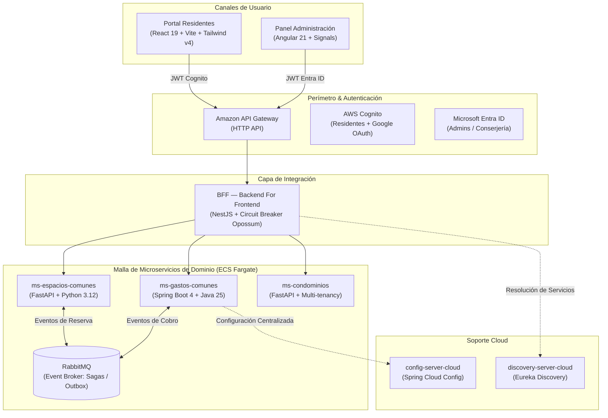

# Convivo — Plataforma Cloud-Native para Condominios Residenciales

  

  
  
  
  
  
  

---

## 🏢 Acerca de Convivo

**Convivo** es una plataforma distribuida *cloud-native* diseñada para la administración integral de condominios habitacionales y comunidades residenciales en Chile, alineada con los requisitos de la **Ley N° 21.442 de Copropiedad Inmobiliaria**.

El sistema moderniza la experiencia comunitaria mediante dos canales especializados:
1. **Portal de Residentes**: Autoservicio para reservas de espacios comunes en tiempo real, consulta y pago de gastos comunes, emisión de pases de visita con código QR y libro digital de novedades.
2. **Panel de Administración**: Gestión operativa centralizada para conserjería y comités (cobros, auditorías, bitácoras de incidentes y control de quórum).

---

## 🏛️ Arquitectura General

La solución adopta una arquitectura de microservicios orientada a eventos con desacoplamiento de capas, tolerancia a fallos y doble proveedor de identidad:

---

## 📦 Ecosistema de Repositorios

Todos los componentes de Convivo se encuentran modularizados en repositorios independientes con pipelines de CI/CD automatizados:

| Repositorio | Tipo | Stack Principal | Responsabilidad |
| :--- | :--- | :--- | :--- |
| [**`Frontend-CloudNative`**](https://github.com/Cloud-Native-Convivo/Frontend-CloudNative) | Frontend | React 19, Vite, Tailwind v4, TypeScript | Portal web para residentes. Autenticación PKCE con Cognito + Google. [Demo en vivo](https://cloud-native-convivo.github.io/Frontend-CloudNative/). |
| [**`panel-administracion-web`**](https://github.com/Cloud-Native-Convivo/panel-administracion-web) | Frontend | Angular 21, Signals, Tailwind v4 | Interfaz administrativa para conserjería y comités de administración. |
| [**`bff`**](https://github.com/Cloud-Native-Convivo/bff) | Gateway / BFF | NestJS 12, TypeScript, Opossum | Agregación de servicios, validación dual de tokens JWT y Circuit Breaker para resiliencia ante degradaciones. |
| [**`ms-espacios-comunes`**](https://github.com/Cloud-Native-Convivo/ms-espacios-comunes) | Microservicio | FastAPI, Python 3.12, SQLAlchemy | Gestión de quinchos, salas de eventos y piscinas con validación estricta de solapamiento horario (409 Conflict). |
| [**`ms-gastos-comunes`**](https://github.com/Cloud-Native-Convivo/ms-gastos-comunes) | Microservicio | Spring Boot 4, Java 25, RabbitMQ | Facturación, cálculo de prorrateos, conciliación de pagos y patrón Inbox/Outbox transaccional. |
| [**`ms-condominios`**](https://github.com/Cloud-Native-Convivo/ms-condominios) | Microservicio | FastAPI, Python 3.12, SQLAlchemy | Multi-tenancy, administración de comunidades, edificios, torres y unidades residenciales. |
| [**`config-server-cloud`**](https://github.com/Cloud-Native-Convivo/config-server-cloud) | Infraestructura App | Spring Cloud Config, Java 25 | Servidor de configuración distribuida y versionada por perfiles de entorno (`dev`, `prod`). |
| [**`discovery-server-cloud`**](https://github.com/Cloud-Native-Convivo/discovery-server-cloud) | Infraestructura App | Spring Cloud Netflix Eureka, Java 25 | Registro dinámico de instancias y balanceo de carga interno a nivel de aplicación. |
| [**`terraform-cloud`**](https://github.com/Cloud-Native-Convivo/terraform-cloud) | IaC AWS | Terraform (~> 6.0), AWS ECS Fargate, VPC | Aprovisionamiento declarativo de infraestructura en AWS: subnets públicas/privadas, NLB interno, API Gateway, Cognito y Secrets Manager. |

---

## 🛡️ Principios Arquitectónicos y Seguridad

- **Seguridad en Profundidad (OWASP Top 10)**: Tráfico HTTPS/TLS forzado, secretos en AWS Secrets Manager (cero credenciales en texto plano o control de versiones), Lambda Authorizer con validación estandarizada y principio de mínimo privilegio en IAM roles.
- **Autenticación Dual Desacoplada**:
  - **Residentes**: AWS Cognito User Pool con flujo Authorization Code + PKCE y federación Google.
  - **Administración**: Microsoft Entra ID para integración corporativa y control basado en roles (RBAC).
- **Consistencia Eventual & Patrón Saga**: Orquestación asíncrona entre microservicios usando colas durables en RabbitMQ con manejo de compensaciones ante fallas.
- **Observabilidad y Calidad**: Cobertura automatizada en CI (Vitest, pytest, JUnit 5), escaneos de seguridad estática con GitHub CodeQL y formateo estricto con `oxfmt` y linters.

---

## 👥 Equipo de Desarrollo

Proyecto desarrollado para la asignatura **Cloud Native I** en **Duoc UC**:

- **Marcelo Rivera** — [@marceloriv](https://github.com/marceloriv)
- **Karina Pimentel**
